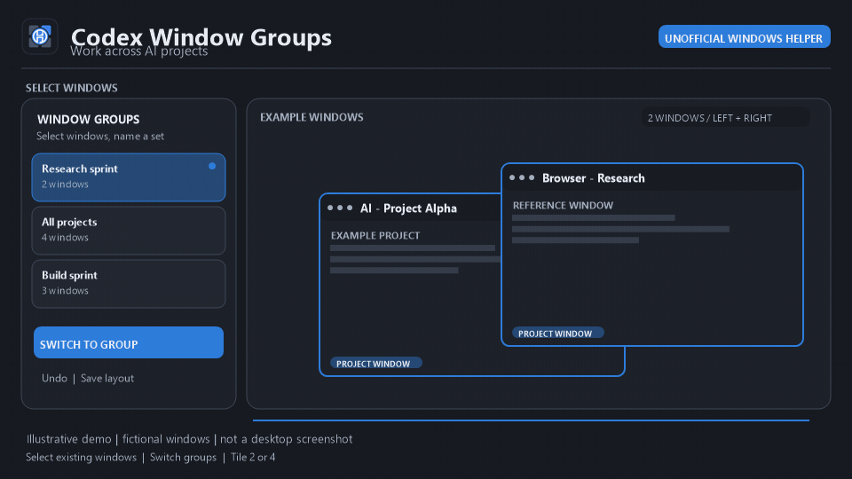

# Codex Window Groups 0.1.6

**An unofficial Windows window helper for people who use AI across several projects at once.**

*Illustrative demo / 功能示意 — fictional project windows, not a desktop screenshot.*

## What it does

- Select existing desktop windows and group them under names you choose.
- Switch to a group with one click.
- Two selected windows tile left and right; four tile in a 2×2 grid on the monitor containing the helper.
- Other group sizes restore their saved layout. Save layout and undo are available.
- The interface supports Simplified Chinese and English.

This is a third-party window-management utility, **not an official OpenAI or Codex plugin**. It does not embed or create AI chats. It uses selected window titles and process metadata to identify windows; it does not read chat or web-page contents or account credentials.

## Downloads

- CodexWindowGroups-DHJ-0.1.6-Setup.exe — per-user installer. No administrator install is intended. It adds a Start menu shortcut; the desktop shortcut is optional.
- CodexWindowGroups-DHJ-0.1.6-portable.zip — portable files. Extract it to a writable folder and run the included executable.

The installer does not bundle personal groups or UI preferences. The portable application creates its own local data files beside the executable when used. No data files from the development machine are included.

## Requirements and limits

- Windows 10 or 11 and the built-in Microsoft .NET Framework 4.x.
- Windows may restrict foreground activation across applications. If a window cannot be brought forward, activate it manually.
- The installer and executable are unsigned. Windows may show an unknown-publisher or reputation warning; do not bypass Windows security prompts.
- Source code and a redistribution license are not included in this preview download.

## 用途

**方便使用 AI 时同时推进多个项目。** 手动选择已有窗口并命名分组，一键切换；两个窗口左右平铺，四个窗口按 2×2 平铺。其他数量恢复已保存布局，也可保存布局或撤销。

这是第三方 Windows 窗口管理工具，**不是 OpenAI 或 Codex 官方插件**。它不会嵌入或创建 AI 对话。它使用所选窗口的标题和进程元数据识别窗口，不读取聊天内容、网页内容或账号凭据。

### 下载内容

- CodexWindowGroups-DHJ-0.1.6-Setup.exe：当前用户安装，添加开始菜单快捷方式；桌面快捷方式可选。
- CodexWindowGroups-DHJ-0.1.6-portable.zip：便携版，解压到可写目录后运行其中的程序。

安装包不包含个人分组或界面偏好。便携版首次使用时会在程序旁创建本地数据文件。本发布候选不包含开发电脑上的任何分组数据。

### 要求与限制

- Windows 10/11，系统自带 Microsoft .NET Framework 4.x。
- Windows 可能限制跨应用前台切换；若窗口未能置前，请手动激活。
- 安装器和程序未签名。Windows 可能显示未知发布者或信誉提示；请勿绕过 Windows 安全提示。
- 此预览下载不含源码或再分发许可。

## Creating the v0.1.6 GitHub Release

The installer and portable ZIP are kept locally in release-assets/. That directory is intentionally ignored by Git, so the binary packages are not part of repository commits.

After reviewing the repository and packages, create a GitHub Release manually:
1. Open the repository Releases page and choose Draft a new release.
2. Create/select tag v0.1.6 on main; use the title Codex Window Groups 0.1.6.
3. Attach release-assets/CodexWindowGroups-DHJ-0.1.6-Setup.exe and release-assets/CodexWindowGroups-DHJ-0.1.6-portable.zip.
4. Check the SHA-256 values in the repository SHA256SUMS.txt before publishing.

No download URL is claimed here; it will exist only after you publish a release.